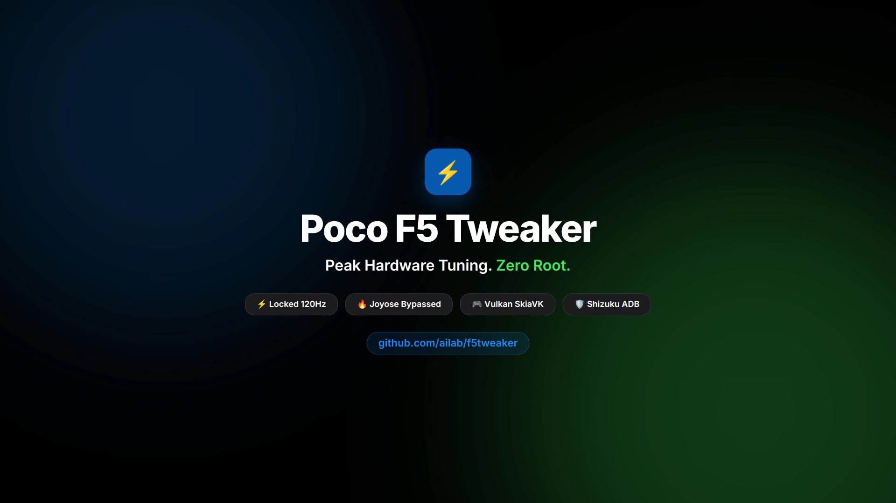

# Poco F5 Tweaker (`marble`)

> Android hardware, kernel, and display tuning suite for the Poco F5 / Redmi Note 12 Turbo (Snapdragon 7+ Gen 2) via Shizuku ADB — zero root required.



---

## Overview

**Poco F5 Tweaker** uncages the full performance potential of the Qualcomm Snapdragon 7+ Gen 2 on Xiaomi HyperOS and MIUI. By interfacing directly with system properties, package managers, and hardware schedulers via **Shizuku**, it applies low-level kernel and display tweaks without unlocking your bootloader or tripping Knox/SafetyNet.

Designed with an Apple HIG Inset Grouped aesthetic built entirely in Jetpack Compose and Material 3.

---

## Key Features

### 1. Global Master Profiles
One-tap system overrides that synchronize display, scheduler, network, and memory parameters:
- **Battery**: Locked 60Hz, power saver scheduler, aggressive Doze mode.
- **Balanced**: Dynamic 90Hz, standard governor, balanced Dalvik heap.
- **Performance**: Locked 120Hz, CPU & GPU boost, Dalvik 384MB heap, Zygote prefork optimization.

### 2. Granular Hardware & Kernel Tuning
- **Display Refresh Rate**: Enforce true locked 60Hz, 90Hz, or 120Hz peak refresh rates.
- **CPU & GPU Power**: Adjust governor aggressiveness and touch-boost frequencies.
- **SurfaceFlinger & Dalvik**: Vsync intervals, hardware UI acceleration, and custom heap thresholds.
- **Multicore Packet Scheduler**: Distribute network packet handling across multiple CPU cores for lowest gaming ping.
- **Touch Responsiveness Boost**: Maximize digitizer polling rate for instant input response.

### 3. HyperOS & MIUI Guardrail Overrides
- **Disable Joyose**: Bypasses MIUI thermal throttling to prevent frame drops in intensive games *(active cooling fan recommended)*.
- **Vulkan UI Renderer (SkiaVK)**: Forces hardware rendering via the Vulkan backend instead of OpenGL ES.
- **Debloat System Services**: Deactivates background analytics, MSA ad services, and daemon trackers.
- **Disable Telemetry**: Terminates diagnostic and error report upload daemons.
- **Harman Kardon Audio DSP**: Activates enhanced audio profiles and spatial clarity.
- **Force Resizable Windows**: Unlocks freeform multi-window mode for all apps.

---

## Architecture & Tech Stack

- **UI Framework**: Modern Jetpack Compose with Material 3 & Inset Grouped design tokens.
- **State Management**: Reactive MVVM using Kotlin Coroutines and `StateFlow`.
- **Privileged Execution**: [Shizuku API](https://shizuku.rikka.app/) for non-root ADB command execution (`ShizukuCommandRunner`).
- **Target Platform**: Poco F5 / Redmi Note 12 Turbo (`marble`), Android 13+ (MIUI 14 / HyperOS).

---

## Requirements

1. **Device**: Poco F5 or Redmi Note 12 Turbo (`marble`).
2. **OS**: MIUI 14 or Xiaomi HyperOS (Android 13+).
3. **[Shizuku](https://shizuku.rikka.app/)**: Installed and running (started via Wireless Debugging or computer ADB).

---

## Getting Started

### Installation
1. Start the **Shizuku** service on your device via Wireless Debugging.
2. Build and install the APK:
   ```bash
   ./gradlew installDebug
   ```
3. Open **Poco F5 Tweaker** and tap **Grant Permission** when prompted by Shizuku.
4. Select your preferred **Master Profile** or configure individual hardware toggles.

### Building from Source
```bash
# Clone the repository
git clone git@github.com:pavloglez/f5tweaker.git
cd f5tweaker

# Compile debug build
./gradlew assembleDebug

# Output APK location
# app/build/outputs/apk/debug/app-debug.apk
```

---

## Safety & Reset Notes

- Settings applied via Shizuku ADB persist until device reboot or manual reversion.
- Toggling **Joyose** removes thermal limits; monitor device temperatures during prolonged gaming sessions.

---

## License

This project is licensed under the Apache License 2.0.
